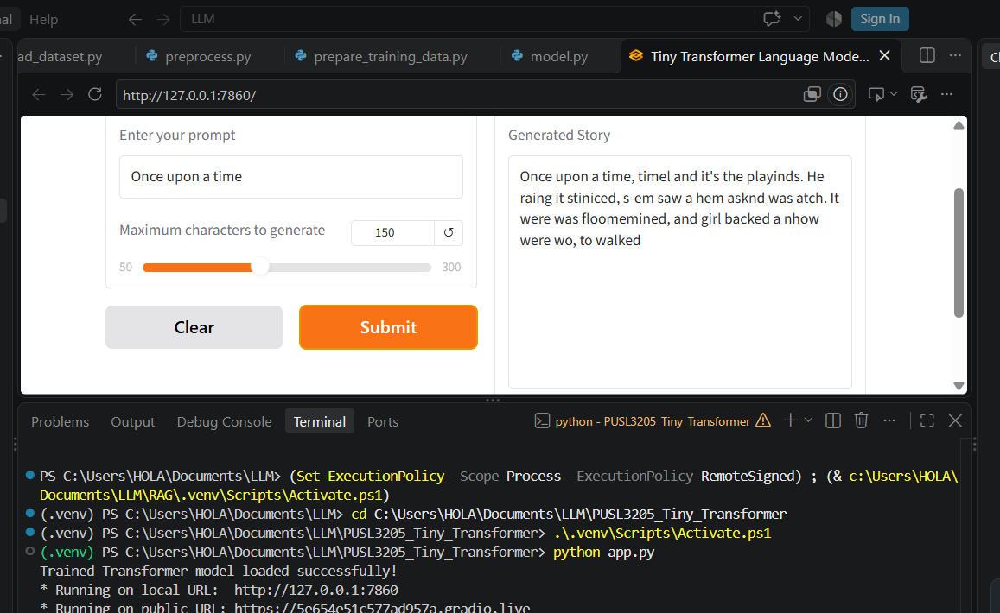

# Lab 03 – Developing a Tiny Transformer Language Model

## Overview
This lab focuses on developing and training a small character-level Transformer language model using Python and PyTorch.

The model was trained using the TinyStories dataset to learn language patterns and generate short text sequences.

## Objectives
- Understand the architecture of Transformer language models.
- Prepare and preprocess text datasets.
- Implement self-attention and multi-head attention.
- Train and evaluate a Tiny Transformer model.
- Generate text using the trained model.
- Experiment with different model configurations.

## Implementation
The project includes:
- Dataset loading and preprocessing
- Character-level tokenization
- Training and validation data preparation
- Transformer architecture implementation
- Model initialization and training
- Model evaluation and text generation
- Gradio-based interactive interface

## Technologies Used
- Python
- PyTorch
- Hugging Face Datasets
- NumPy
- Pandas
- Matplotlib
- Gradio

## Model Configuration
| Parameter | Value |
|---|---:|
| Vocabulary Size | 75 |
| Block Size | 64 |
| Embedding Dimension | 128 |
| Attention Heads | 8 |
| Transformer Layers | 3 |
| Dropout | 0.1 |
| Learning Rate | 0.001 |

## Results
The final model achieved:
- Training Loss: 1.5197
- Validation Loss: 1.5435
- Validation Perplexity: 4.6636

The experiments showed improved validation performance when the number of transformer layers and attention heads was increased.

See the `results/` folder for the training loss graph and training history.

## Interactive Demo
A Gradio interface was developed to allow users to enter a starting prompt and generate text using the trained Transformer model.

## Project Structure
```text
Lab-03-Tiny-Transformer/
├── README.md
├── notebooks/
│   └── Python implementation files
└── results/
    ├── README.md
    ├── loss_curve.png
    └── training_history.csv
```

## Learning Outcomes
Through this lab, I gained practical experience in Transformer architecture, self-attention, language model training, model evaluation, and text generation.

